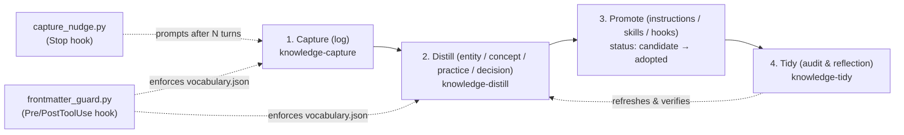

# Personal Knowledge

A personal knowledge management framework, Agent Plugin (for Antigravity and Claude Code), and containerized runtime built on top of [Basic Memory](https://github.com/basicmachines-co/basic-memory) over the Model Context Protocol (MCP) to accumulate and curate your own engineering knowledge across projects.

## Why This Exists

Built-in agent memories and uncurated Markdown folders tend to decay into stale, contradictory notes over time:

- **One-off observations pile up** alongside established rules, making agents repeat outdated claims as facts.
- **Work and personal contexts leak** when a single flat memory store mixes client-specific details with general engineering insights.
- **Metadata drifts** without schema enforcement, breaking search filters and knowledge-graph traversal.

`personal-knowledge` addresses this by separating raw session logs from distilled knowledge, enforcing a closed frontmatter vocabulary with lightweight hooks, and promoting recurring practices into version-controlled rules, skills, or lints.

## Knowledge Lifecycle



- **Raw logs (`log`)**: Append-only incident records captured during a session.
- **Distilled knowledge (`entity`, `concept`, `decision`, `practice`)**: Evergreen notes derived from logs (`derived_from`), evolving in place (or superseded cleanly for ADRs).
- **Promotion**: Once a `practice` recurs or is adopted as a human convention, its rule moves into a repository's instructions, skill, or hook (`status: adopted` with `promoted_to`), leaving only `rationale` and `technique` in the note.
- **Tidying (`reflection`)**: Periodic audits check `bm_schema` validation, broken relations, confidence upgrades, and promotion target links.

## Verified Environments & Client Support

| Client | MCP Tools | Lifecycle Hooks (`PreToolUse` / `PostToolUse` / `Stop`) | Status |
| --- | --- | --- | --- |
| **Claude Code** (CLI / VS Code) | Yes | Yes | Verified on Linux / WSL2 |
| **Antigravity** (App / IDE / CLI) | Yes | Yes (`PreToolUse` & `Stop`) | Verified on Linux / WSL2 |
| **Claude Desktop** (Code tab) | Yes | Yes (shares Claude Code engine) | Supported (not directly verified) |
| **Claude Desktop** (Chat tab) / Web clients (`claude.ai`, Gemini Web, ChatGPT) | Yes (remote endpoint) | No (MCP connection only) | MCP only |

## Quick Start

### Prerequisites

- **Docker** (with Compose) or an existing `basic-memory` MCP server
- **Python 3.11+** on the client machine for plugin hooks (`capture_nudge.py`, `frontmatter_guard.py`) and utility scripts (Debian 12+ and Ubuntu 24.04+ ship 3.11+; on macOS, Xcode CLT `/usr/bin/python3` is 3.9.6 so Homebrew or python.org Python 3.11+ is recommended; on Windows, install Python 3.11+ separately)

### 1. Start the Basic Memory MCP Container

By default, the plugin connects to `http://localhost:48000/mcp` (avoiding port `8000`, which often collides with local development servers).

```bash
docker compose up -d
```

This builds from [Dockerfile](Dockerfile) (wrapping `ghcr.io/basicmachines-co/basic-memory` with the backup/restore scripts included) and binds port `48000` on `127.0.0.1` to container port `8000`.

### 2. Install the Agent Plugin

- **Antigravity (App / IDE / CLI)**: Copy or symlink [plugins/personal-knowledge](plugins/personal-knowledge) into `~/.gemini/config/plugins/personal-knowledge`.
- **Claude Code**: Add this repository via [.claude-plugin/marketplace.json](.claude-plugin/marketplace.json) or install from [plugins/personal-knowledge](plugins/personal-knowledge).

## Optional: Remote or Custom Endpoint

Antigravity's `mcp_config.json` does not expand environment variables in `url` / `serverUrl`, so connecting to a non-default port, LAN IP, or authenticated TLS/OAuth endpoint uses [scripts/build-local-plugin.sh](scripts/build-local-plugin.sh) to generate a tailored plugin directory:

```bash
./scripts/build-local-plugin.sh "https://bm.example.com/mcp" "$HOME/.gemini/config/plugins/personal-knowledge"
```

You can also pass the URL via `BASIC_MEMORY_MCP_URL`:

```bash
BASIC_MEMORY_MCP_URL="https://bm.example.com/mcp" ./scripts/build-local-plugin.sh
```

> [!IMPORTANT]
> If you expose `basic-memory` beyond `127.0.0.1`, place it behind an authenticating reverse proxy or Zero Trust Access layer (see [SECURITY.md](SECURITY.md)).

## Customization

- **Closed Vocabulary ([plugins/personal-knowledge/vocabulary.json](plugins/personal-knowledge/vocabulary.json))**: Defines allowed `type`, `status` (by type), `originKind`, and `tags`. Customize `tags` to match your own domains and tech stack.
- **Per-Environment `origin.project` Allowlist**: Optionally create `$XDG_CONFIG_HOME/personal-knowledge/projects.json` (or set `PK_PROJECTS_FILE`) containing a JSON array of allowed project slugs, e.g. `["acme", "homelab"]`. When present, [frontmatter_guard.py](plugins/personal-knowledge/scripts/frontmatter_guard.py) blocks writes with unlisted `origin.project` slugs.
- **Capture Nudge Threshold**: Set `PK_CAPTURE_NUDGE_TURNS` (default: `10`) to control how many turns without a knowledge-base write trigger [capture_nudge.py](plugins/personal-knowledge/scripts/capture_nudge.py).

## Backup, Verification, and Restore

The repository includes standalone Bash/Python scripts that back up the Markdown source of truth and `.basic-memory/config.json` while excluding derived SQLite caches (`.basic-memory/memory.db*`):

```bash
# Create, verify, and rotate backups (default: keep 7 generations)
HOST_DATA_PATH=/path/to/data BACKUP_DIR=/path/to/backups ./scripts/backup.sh

# Verify a single archive or all backups in a directory
./scripts/verify-backup.sh /path/to/backups/basic-memory-backup-YYYYMMDD-HHMMSS.tar.gz
./scripts/verify-backup.sh --all /path/to/backups

# Restore from an archive (creates a safety pre-restore archive first)
HOST_DATA_PATH=/path/to/data ./scripts/restore.sh /path/to/backups/basic-memory-backup-YYYYMMDD-HHMMSS.tar.gz
```

Optionally set `ENV_FILE=/path/to/.env` to load `HOST_DATA_PATH` / `BACKUP_DIR` / `BACKUP_KEEP_GENERATIONS` from an env file, and set `BASIC_MEMORY_UID_GID` (e.g., `1000:1000`) when running `restore.sh` as `root` to align file ownership.

## Repository Layout

```text
.
├── .claude-plugin/               # Claude Code marketplace manifest
├── .github/                      # CI, multi-arch Docker image build, and Dependabot config
├── AGENTS.md                     # Agent operational and plugin sync rules
├── CONTRIBUTING.md               # Contribution guidelines
├── Dockerfile                    # Basic Memory MCP image with bundled backup scripts
├── LICENSE                       # MIT License (repository source)
├── README.md                     # This file
├── SECURITY.md                   # Security policy and reporting instructions
├── docker-compose.yml            # Default localhost container setup (127.0.0.1:48000 -> 8000)
├── plugins/
│   └── personal-knowledge/       # Antigravity & Claude Code Agent Plugin (MCP, rules, skills, hooks)
├── scripts/
│   ├── backup.sh                 # Archive data directory, verify, and rotate generations
│   ├── build-local-plugin.sh     # Generate plugin bundle with a custom MCP URL
│   ├── restore.sh                # Verify and restore from a backup archive
│   └── verify-backup.sh          # Validate archive integrity and layout
└── tests/                        # Python unittest suite (stdlib only)
```

## Development & Tests

All Python hooks and tests depend on the Python 3.11+ standard library only:

```bash
python3 -m unittest discover -s tests -v
```

## Tools & References

### Core Tools
- [Basic Memory](https://github.com/basicmachines-co/basic-memory) — Markdown-based knowledge graph exposed via MCP.
- [Model Context Protocol (MCP)](https://modelcontextprotocol.io/) — Standard protocol for connecting AI clients to external tools and context.

### Concepts & Further Reading
- **Zettelkasten & Evergreen Notes** — Atomic, concept-oriented notes linked together rather than siloed by folder ([Andy Matuschak's Evergreen Notes](https://notes.andymatuschak.org/Evergreen_notes)).
- **Architecture Decision Records (ADRs)** — Immutable decision records with explicit supersession rather than silent edits ([Michael Nygard, *Documenting Architecture Decisions*](https://cognitect.com/blog/2011/11/15/documenting-architecture-decisions)).

## License

- **Repository source code and documentation**: Licensed under the [MIT License](LICENSE).
- **Published container images** (`ghcr.io/fuji44/personal-knowledge`): Built on top of [basicmachines-co/basic-memory](https://github.com/basicmachines-co/basic-memory) and therefore distributed under **AGPL-3.0-only**.
