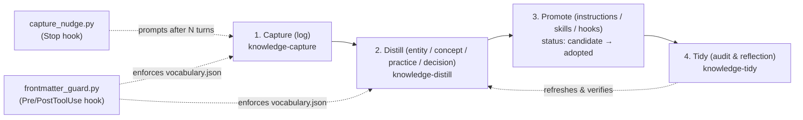

# Personal Knowledge

A personal knowledge management framework, Agent Plugin (for Antigravity and Claude Code), and containerized runtime built on top of [Basic Memory](https://github.com/basicmachines-co/basic-memory) over the Model Context Protocol (MCP) to accumulate and curate your own engineering knowledge across projects.

## Why This Exists

Built-in agent memories and uncurated Markdown folders tend to decay into stale, contradictory notes over time:

- **One-off observations pile up** alongside established rules, making agents repeat outdated claims as facts.
- **Work and personal contexts leak** when a single flat memory store mixes client-specific details with general engineering insights.
- **Metadata drifts** without schema enforcement, breaking search filters and knowledge-graph traversal.

`personal-knowledge` addresses this by separating raw session logs from distilled knowledge, enforcing a closed frontmatter vocabulary with lightweight hooks, and promoting recurring practices into version-controlled rules, skills, or lints.

## Knowledge Lifecycle



See [docs/concepts.md](docs/concepts.md) for how each stage works and how work/personal scopes stay separated.

## Quick Start

The fastest way to try `personal-knowledge` locally (requires **Python 3.11+**, **[uv](https://docs.astral.sh/uv/)**, and **Claude Code**):

1. Start the Basic Memory MCP server (default port `48000` avoids colliding with dev servers on `8000`):

   ```bash
   uvx --prerelease=allow basic-memory mcp --transport streamable-http --host 127.0.0.1 --port 48000
   ```

2. Clone this repository and launch Claude Code with the plugin:

   ```bash
   git clone https://github.com/fuji44/personal-knowledge.git
   claude --plugin-dir ./personal-knowledge/plugins/personal-knowledge
   ```

Then ask: *"List available Basic Memory projects."*

## Next Steps

- [Setup Guide](docs/setup.md) — Full step-by-step installation, alternative server runtimes, client setup, customization, and backups.
- [Local Host + Cloudflare](docs/guides/cloudflare-remote.md) — Secure remote access for multiple devices or web clients.
- [Concepts & References](docs/concepts.md) — Knowledge lifecycle and work/personal scope separation.

## License

- **Repository source code and documentation**: Licensed under the [MIT License](LICENSE).
- **Published container images**: Built on top of [basicmachines-co/basic-memory](https://github.com/basicmachines-co/basic-memory) and therefore distributed under **AGPL-3.0-only**.
