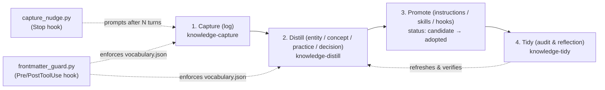

# Personal Knowledge

A personal knowledge management framework, Agent Plugin (for Antigravity and Claude Code), and containerized runtime built on top of [Basic Memory](https://github.com/basicmachines-co/basic-memory) over the Model Context Protocol (MCP) to accumulate and curate your own engineering knowledge across projects.

## Why This Exists

Built-in agent memories and uncurated Markdown folders tend to decay into stale, contradictory notes over time:

- **One-off observations pile up** alongside established rules, making agents repeat outdated claims as facts.
- **Work and personal contexts leak** when a single flat memory store mixes client-specific details with general engineering insights.
- **Metadata drifts** without schema enforcement, breaking search filters and knowledge-graph traversal.

`personal-knowledge` addresses this by separating raw session logs from distilled knowledge, enforcing a closed frontmatter vocabulary with lightweight hooks, and promoting recurring practices into version-controlled rules, skills, or lints.

## Knowledge Lifecycle



See [docs/concepts.md](docs/concepts.md) for how each stage works and how work/personal scopes stay separated.

## Quick Start

### Prerequisites

- **Docker** (with Compose) or an existing `basic-memory` MCP server
- **Python 3.11+** on the client machine for plugin hooks and utility scripts (verify with `python3 --version`; macOS system Python and Windows may require installing Python 3.11+ separately)

### 1. Start the Basic Memory MCP Container

By default, the plugin connects to `http://localhost:48000/mcp` (avoiding port `8000`, which often collides with local development servers).

```bash
docker compose up -d
```

This builds from [Dockerfile](Dockerfile) and binds port `48000` on `127.0.0.1` to the container's MCP port.

### 2. Install the Agent Plugin

- **Antigravity (App / IDE / CLI)**: Copy or symlink [plugins/personal-knowledge](plugins/personal-knowledge) into `~/.gemini/config/plugins/personal-knowledge`.
- **Claude Code**: Add this repository via [.claude-plugin/marketplace.json](.claude-plugin/marketplace.json) or install from [plugins/personal-knowledge](plugins/personal-knowledge).

## Documentation

| Document | Contents |
| --- | --- |
| [docs/concepts.md](docs/concepts.md) | Knowledge lifecycle, scope separation, tools, and references |
| [docs/configuration.md](docs/configuration.md) | Verified environments, client support matrix, custom/remote endpoints, and customization |
| [docs/operations.md](docs/operations.md) | Backup, integrity verification, and restore workflows |
| [CONTRIBUTING.md](CONTRIBUTING.md) | Development workflow, MCP config synchronization, and unit tests |
| [SECURITY.md](SECURITY.md) | Security policy, vulnerability reporting, and operational guidelines |

## License

- **Repository source code and documentation**: Licensed under the [MIT License](LICENSE).
- **Published container images**: Built on top of [basicmachines-co/basic-memory](https://github.com/basicmachines-co/basic-memory) and therefore distributed under **AGPL-3.0-only**.
