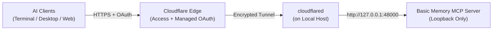

# Local Host + Cloudflare (Secure Remote Access)

This guide shows how to run Basic Memory on a local host (home server, desktop, NAS, or always-on workstation) and access it securely over HTTPS from multiple devices or web clients—**without opening router ports or writing custom OAuth server code**.



## Prerequisites

- A **Cloudflare account** (the Free plan includes Cloudflare Tunnel and Cloudflare Access for up to 50 users).
- A **domain managed by Cloudflare DNS** (e.g., `example.com`).
- A **local host** running Docker (with Compose) and `cloudflared`.
- **Python 3.11+** on each client machine running the Agent Plugin.

## Step 1: Run Basic Memory on the Local Host

Clone the repository on your local host and start Basic Memory bound strictly to `127.0.0.1:48000`:

```bash
git clone https://github.com/fuji44/personal-knowledge.git
cd personal-knowledge
docker compose up -d
```

> [!NOTE]
> Prefer running Basic Memory with `uv` (no Docker) or standalone `docker run`? See [Running the Basic Memory Server](./server.md) and ensure it binds only to `127.0.0.1:48000`.

> [!IMPORTANT]
> Do not expose port `48000` on `0.0.0.0` or forward it on your router. Keeping Basic Memory on loopback ensures all external traffic passes through Cloudflare Access.

## Step 2: Create a Cloudflare Tunnel (`cloudflared`)

1. Open the **Cloudflare Dashboard** and go to **Zero Trust** (or **Networking**) → **Tunnels** → **Create a tunnel** (see [Cloudflare Tunnel dashboard setup](https://developers.cloudflare.com/cloudflare-one/networks/connectors/cloudflare-tunnel/get-started/create-remote-tunnel/)).
2. Choose **Cloudflared**, name the tunnel (e.g., `personal-knowledge`), and save.
3. Install and run `cloudflared` on your local host using the command shown on the dashboard:
   - **Native service**: Install `cloudflared` on the host and run `sudo cloudflared service install <TUNNEL_TOKEN>`.
   - **Docker**: Run `cloudflare/cloudflared:latest` with `tunnel --no-autoupdate run --token <TUNNEL_TOKEN>` on a shared Docker network targeting `http://basic-memory:8000`.
4. Under **Published application routes** (or **Public Hostname**), add a route:
   - **Public hostname**: e.g., `bm.example.com`
   - **Service**: `http://127.0.0.1:48000` (or `http://basic-memory:8000` if both run in the same Docker network)

> [!WARNING]
> Once the route is saved, `https://bm.example.com` is reachable from the Internet until protected in Step 3. Complete Step 3 immediately before storing sensitive notes.

## Step 3: Protect with Cloudflare Access & Managed OAuth

Put Cloudflare Access in front of `bm.example.com` and enable **Managed OAuth** so non-browser MCP clients can authenticate via standard OAuth instead of hitting a browser-only `302` redirect:

1. In the Cloudflare Zero Trust dashboard, go to **Access controls** → **Applications** → **Add an application** → **Self-hosted** (see [Self-hosted Access applications](https://developers.cloudflare.com/cloudflare-one/access-controls/applications/http-apps/self-hosted-public-app/)).
2. Set the **Application domain** to your tunnel hostname (e.g., `bm.example.com`).
3. Add an **Access Policy** allowing only your identity (e.g., Action: `Allow`, Include: `Emails` → your email address).
4. Under **Advanced settings**, turn on **Managed OAuth** (see [Managed OAuth for Cloudflare Access](https://developers.cloudflare.com/changelog/post/2026-03-20-managed-oauth/)).
5. Save the application.

With **Managed OAuth** enabled, unauthenticated requests to `https://bm.example.com/mcp` return HTTP `401` with `WWW-Authenticate` discovery metadata, allowing MCP clients to open your browser for Access login and obtain an OAuth token automatically.

## Step 4: Connect Your Clients

Point your clients at `https://bm.example.com/mcp` using [Client Setup](./clients.md) (both Claude Code and Antigravity let you specify the remote MCP server URL directly when installing or enabling the plugin).

## Step 5: Authenticate and Verify

1. Start a session in your AI client and ask:
   > List available Basic Memory projects.
2. Complete the Cloudflare Access browser login when prompted on first connection.
3. Confirm that `bm_project(command="list")` returns your projects.

## Troubleshooting

- **Client hangs or fails with a `302` redirect / HTML login page**: Confirm **Managed OAuth** is turned on under **Advanced settings** of your Cloudflare Access self-hosted application.
- **`502 Bad Gateway` from Cloudflare**: Verify Basic Memory is running and the tunnel Service URL matches the address reachable from `cloudflared` (`http://127.0.0.1:48000` for native `cloudflared`, or `http://basic-memory:8000` on a shared Docker network).

## Security & Operations

- Review [SECURITY.md](../../SECURITY.md) for operational security guidelines and scope isolation rules.
- Configure regular backups of your local host's Markdown data using [docs/operations.md](../operations.md).
