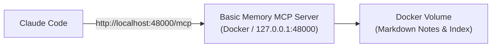

# Setup Guide

This guide walks you through setting up `personal-knowledge` step by step on a single machine using **Docker Compose** and **Claude Code**.



## Prerequisites

- **Docker** (with Docker Compose)
- **Python 3.11+** on your machine for plugin hooks (`python3 --version`)
- **Claude Code**

## Step 1: Clone the Repository

```bash
git clone https://github.com/fuji44/personal-knowledge.git
cd personal-knowledge
```

## Step 2: Start the Basic Memory MCP Server

Start the server bound exclusively to `127.0.0.1:48000`:

```bash
docker compose up -d
```

Verify the container is healthy:

```bash
docker compose ps
```

> [!NOTE]
> Want to run Basic Memory with `uv` (no Docker) or standalone `docker run`? See [Running the Basic Memory Server](./guides/server.md).

## Step 3: Install the Plugin in Claude Code

Add this repository as a local marketplace and install the plugin:

```text
/plugin marketplace add ./
/plugin install personal-knowledge@personal-knowledge
```

Restart or start a new Claude Code session so MCP tools and hooks are active.

> [!NOTE]
> Using Antigravity, Codex, Desktop, or Web clients? See [Client Setup](./guides/clients.md).

## Step 4: Verify Connection and Create Your First Project

Start a conversation and ask:

> List available Basic Memory projects.

If the connection succeeds, the agent will call `bm_project(command="list")`.

Next, create a general-purpose project (for example, `general`) and save a test note:

> Create a Basic Memory project named `general` and save a test note confirming the setup works.

Once that succeeds, you are ready to use the full lifecycle (`knowledge-capture` → `knowledge-distill` → `knowledge-tidy`).

## Troubleshooting

- **Connection refused on `localhost:48000`**: Confirm the container is running (`docker compose ps`). If port `48000` is in use, set `HOST_PORT` and regenerate the plugin with `./scripts/build-local-plugin.sh "http://localhost:<PORT>/mcp"` (see [Configuration](./configuration.md)).
- **Hook errors mentioning Python**: Ensure `python3 --version` reports `3.11` or newer on your `PATH`.
- **Plugin changes not reflected**: Restart your client session after installing or updating the plugin.

## Next Steps

- Access your knowledge base from multiple devices or web clients: [Local Host + Cloudflare](./guides/cloudflare-remote.md)
- Understand the knowledge lifecycle and scope separation: [Concepts & References](./concepts.md)
- Customize vocabulary and hooks: [Configuration](./configuration.md)
- Set up periodic backups: [Operations](./operations.md)
